# 🏦 UPI Gateway

<h3 align="center">A Multi-Merchant UPI Payment Gateway</h3>

<p align="center">
  A self-hosted payment infrastructure for Indian merchants, featuring dynamic UPI QR codes, payment verification, account rotation, and secure webhook notifications.
</p>

<p align="center">
  
  
  
  
</p>

<p align="center">
  <a href="#-features">Features</a> ·
  <a href="#-screenshots">Screenshots</a> ·
  <a href="#-architecture">Architecture</a> ·
  <a href="#-installation">Installation</a> ·
  <a href="#-api-reference">API Reference</a>
</p>

---

> [!IMPORTANT]
> **Development Notice — November 2026**
>
> We are actively working on bug fixes, security improvements, payment verification reliability, webhook delivery guarantees, and production-readiness enhancements.
>
> The project is currently undergoing additional testing and independent review. Some issues are still being addressed.
>
> **Production deployment is not recommended until all ongoing fixes and verification are complete.**
>
> Further updates will be published as improvements are completed and verified.

## 📖 Overview

UPI Gateway is a self-hosted, multi-merchant payment management platform designed for businesses that want to integrate UPI payments into their applications.

Each merchant can configure their own UPI accounts, generate dynamic payment QR codes, track transactions, and receive automated payment notifications.

**Payments are intended to go directly to the configured merchant UPI accounts. The platform is not designed to hold or pool merchant funds.**

### Key Capabilities

- Multi-merchant account management
- Dynamic UPI QR generation and hosted checkout
- Automated payment verification integrations
- Multiple UPI account rotation and daily limits
- Separate Live and Sandbox environments
- Secure HMAC-SHA256 webhook signatures
- Manual UTR verification and review flow
- Merchant API authentication
- Centralized administration dashboard
- Browser-based installation wizard for cPanel and VPS deployments

---

## 📸 Screenshots

### Homepage
<p align="center">
  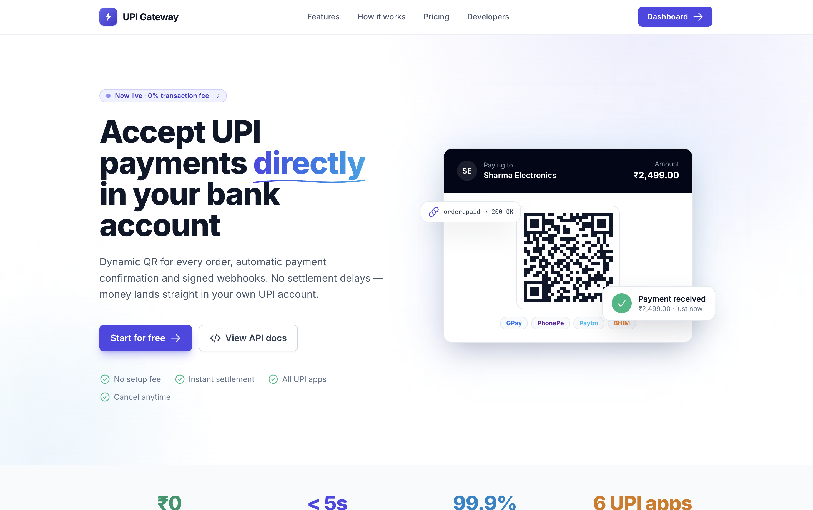
</p>

### Features
<p align="center">
  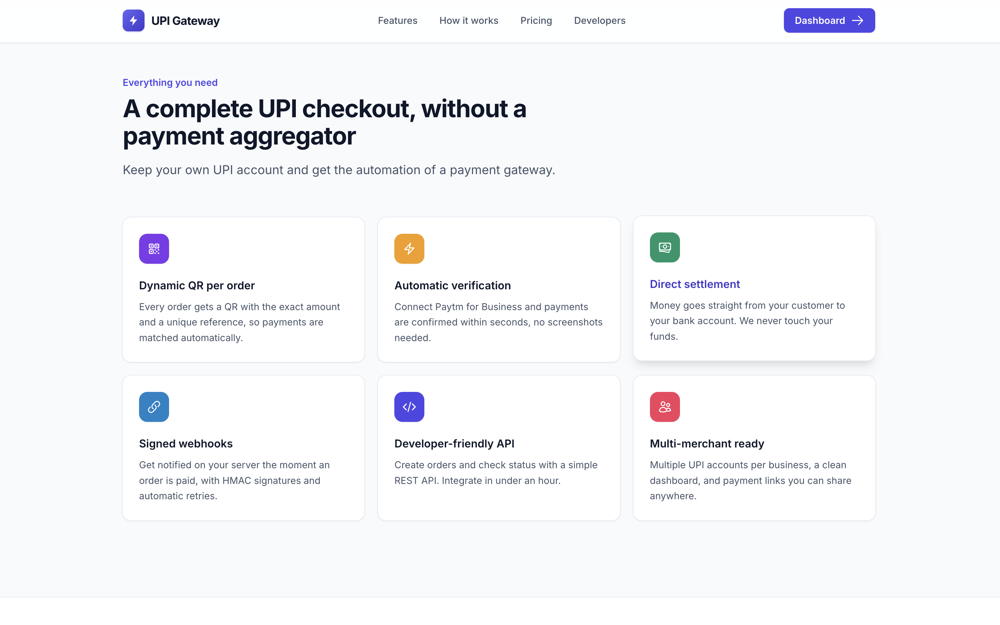
</p>

### API Documentation
<p align="center">
  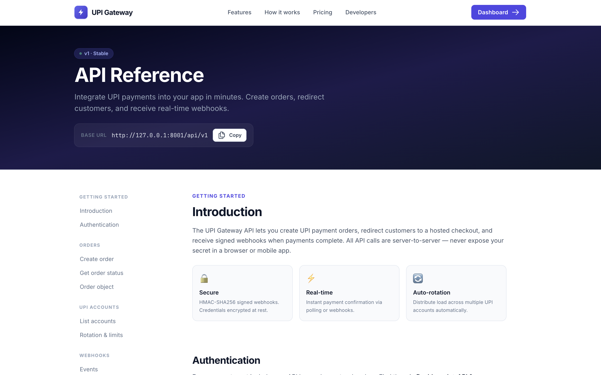
</p>

### Admin Dashboard
<p align="center">
  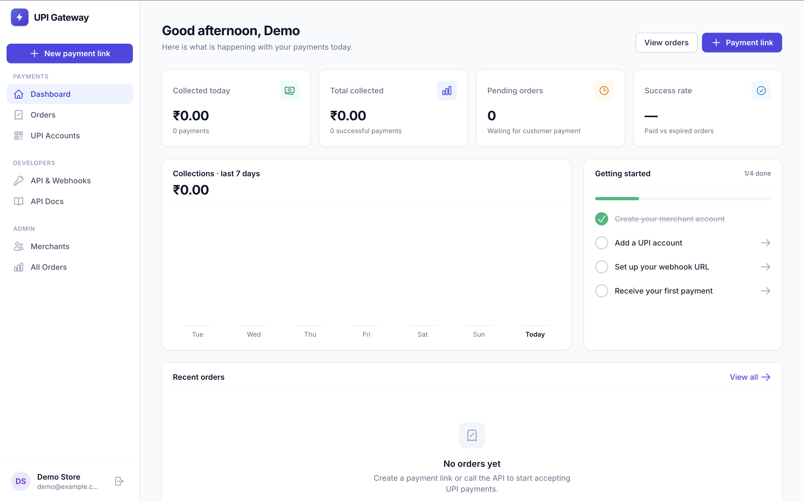
</p>

### Payment Account Management
<p align="center">
  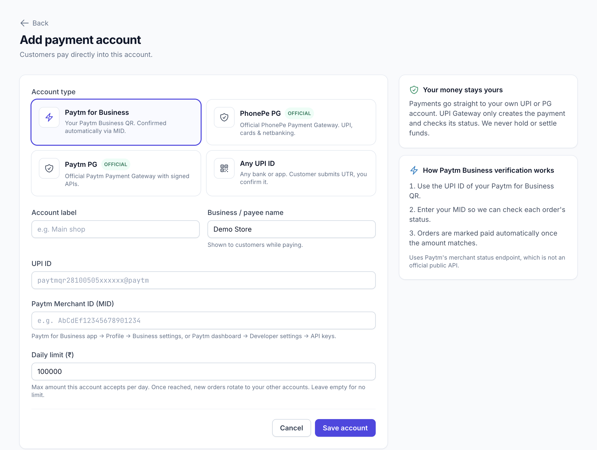
</p>

### Customer Payment Experience

<table>
  <tr>
    <td width="50%">
      <p align="center"><b>Payment Page</b></p>
      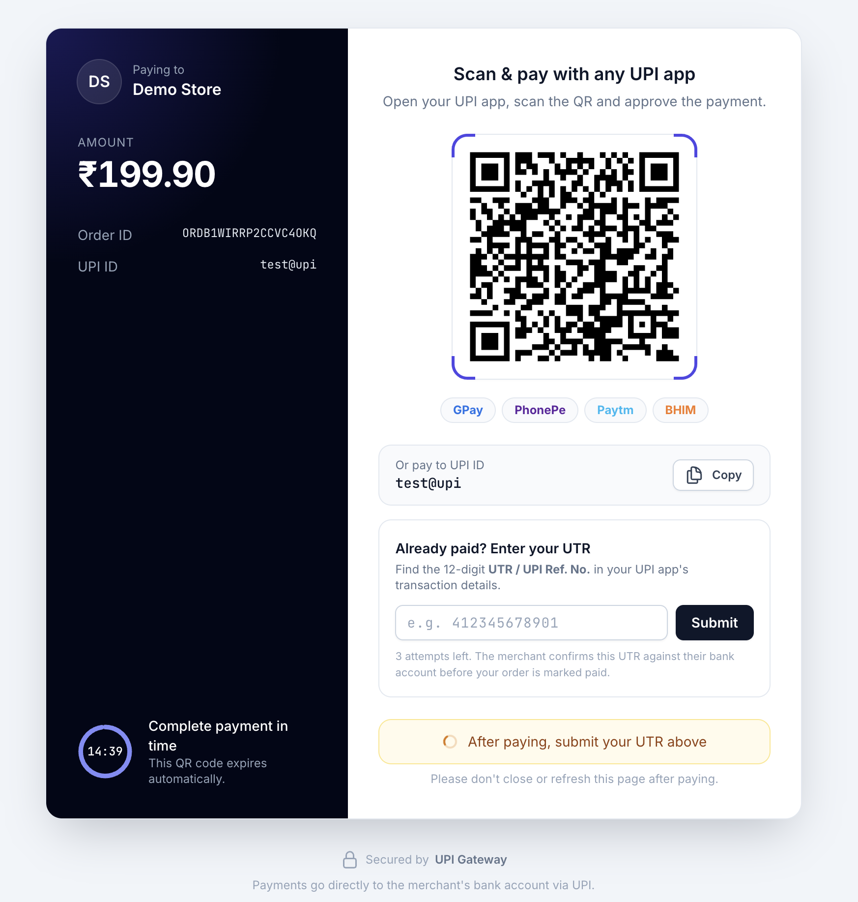
    </td>
    <td width="50%">
      <p align="center"><b>Payment Verification</b></p>
      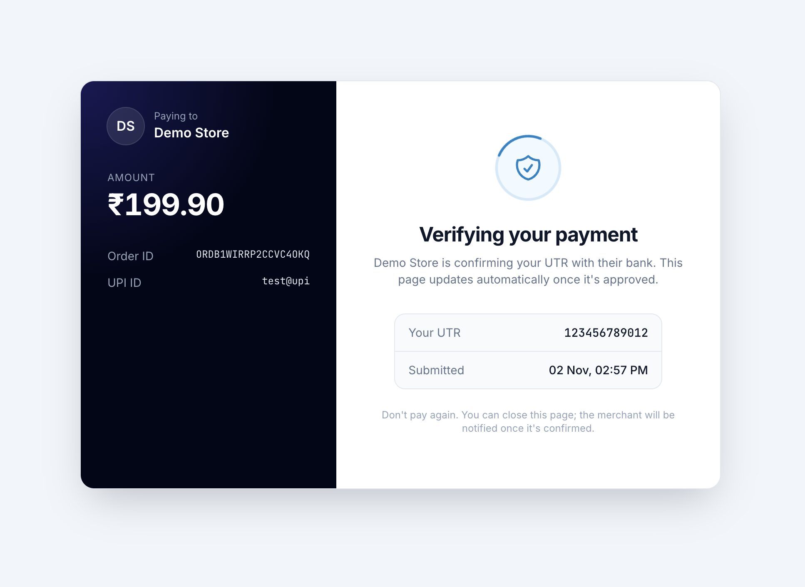
    </td>
  </tr>
  <tr>
    <td colspan="2">
      <p align="center"><b>Payment Success</b></p>
      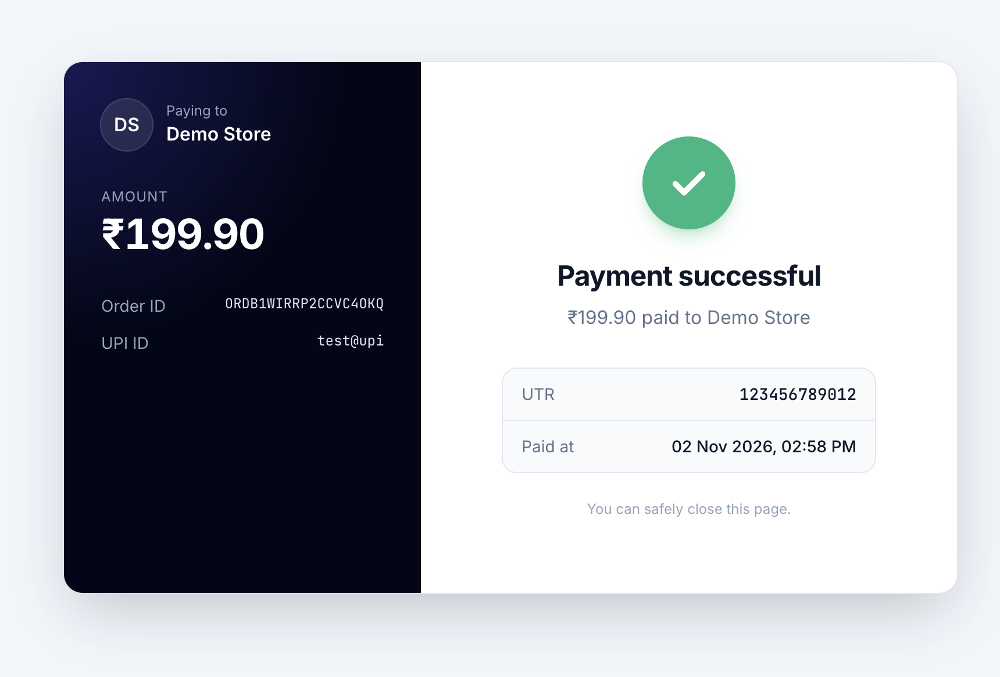
    </td>
  </tr>
</table>

---

## ✨ Features

### 🏢 Multi-Merchant Management
- Independent merchant accounts.
- Merchant-specific API credentials.
- Individual UPI payment account configuration.
- Centralized administration and monitoring.

### 📱 Dynamic UPI Payments
- Dynamic UPI payment QR generation.
- Unique transaction reference for every order.
- Hosted checkout and payment pages.
- UPI intent integration.

### 🔄 Payment Verification
- Paytm for Business verification integration.
- Paytm Payment Gateway integration.
- PhonePe Payment Gateway integration.
- Manual UTR verification and review fallback.

### ⚖️ UPI Account Rotation
- Configure multiple UPI accounts.
- Distribute payment requests across configured accounts.
- Account-level daily limits.
- Merchant-specific account management.

### 🧪 Live & Sandbox Environments
- Separate Live and Sandbox credentials.
- Isolated test and live transactions.
- Sandbox transactions do not represent real payments.

### 🔔 Webhook Notifications
- HMAC-SHA256 request signatures.
- `order.paid` and `order.expired` events.
- Webhook delivery logs.
- Retry handling.

### 🛡️ Security & Administration
- API key and secret authentication.
- Merchant isolation.
- Transaction monitoring.
- Admin dashboard.
- Payment verification history.
- Installation lock after successful setup.

---

## 🏗️ System Architecture

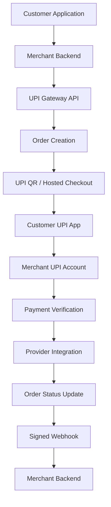

### Payment Lifecycle

1. Merchant creates a payment order through the API.
2. Gateway generates a unique order reference and payment URL.
3. Customer scans the QR code or opens a UPI intent.
4. Customer completes the payment using their UPI application.
5. Gateway checks payment status through the configured verification integration.
6. Order status is updated after successful verification.
7. Merchant receives a signed webhook notification.

---

## ⚙️ Technology Stack

<p align="center">
  
</p>

| Component | Technology |
|---|---|
| Backend Framework | Laravel 12 |
| Programming Language | PHP 8.2+ |
| Database | MySQL 8.x (mandatory) |
| Frontend | Blade / JavaScript |
| Queue Processing | Laravel Queue |
| API Authentication | API Key & Secret |
| Webhook Security | HMAC-SHA256 |
| Web Server | Nginx / Apache-compatible PHP hosting |
| Build Tools | Composer, Node.js, NPM |

---

## 🚀 Installation

UPI Gateway includes a **browser-based Installation Wizard**. You do not need to run Laravel installation commands through the browser. First prepare your hosting environment and MySQL database, then complete the wizard.

Both supported deployment paths use the **same Installation Wizard**:

- **cPanel shared hosting:** prepare the hosting account, upload the prepared production package, and create a MySQL database in cPanel.
- **Ubuntu VPS:** prepare Ubuntu, Nginx, PHP-FPM, and MySQL, then configure the application web root.

### Installation Guides

| Guide | Description |
|---|---|
| [Web Installation Wizard](docs/INSTALLATION.md) | Step-by-step explanation of every wizard screen |
| [cPanel Installation](docs/CPANEL.md) | Shared hosting setup, database creation, upload, and wizard |
| [Ubuntu VPS Installation](docs/VPS.md) | Ubuntu, Nginx, PHP-FPM, MySQL, SSL, queue, and scheduler |

### Server Requirements

- PHP 8.2 or newer.
- MySQL database (mandatory; SQLite is not supported for application runtime).
- PDO and PDO MySQL.
- Required Laravel PHP extensions, including cURL, OpenSSL, Mbstring, Tokenizer, XML, JSON, and Fileinfo.
- Writable Laravel runtime directories with appropriately restricted permissions.
- HTTPS for production deployments.
- A prepared production package containing Composer dependencies and compiled frontend assets.

Check the deployment-specific guide for the complete server preparation instructions. Hosting environments can differ, so verify PHP extensions and database access with your hosting provider.

### 1. Prepare Your Hosting

Before opening the wizard:

- Configure the domain or subdomain.
- Select PHP 8.2 or newer and enable the required PHP extensions.
- Create a MySQL database and database user.
- Assign the required privileges to that user.
- Configure the web server document root to point to the Laravel `public/` directory.
- Enable HTTPS.

**cPanel users:** Create the database and user through **MySQL Database Wizard** (or **MySQL Databases**) in cPanel. Save the full database name, username, and password. cPanel may prepend your hosting account username to the database and user names.

**VPS users:** Install and configure Nginx, PHP-FPM, MySQL, required PHP extensions, and the application files as described in the [VPS guide](docs/VPS.md).

### 2. Open the Installation Wizard

Visit your domain:

```text
https://yourdomain.com/install
```

The wizard guides you through the following steps.

#### Step 1 — Requirements Check

The wizard checks whether the server meets the application's installation requirements. Resolve any failed requirement in your hosting control panel or server configuration before continuing.

#### Step 2 — Database Setup

Enter your application name and URL, then select MySQL and provide the database connection details created during server preparation.

<p align="center">
  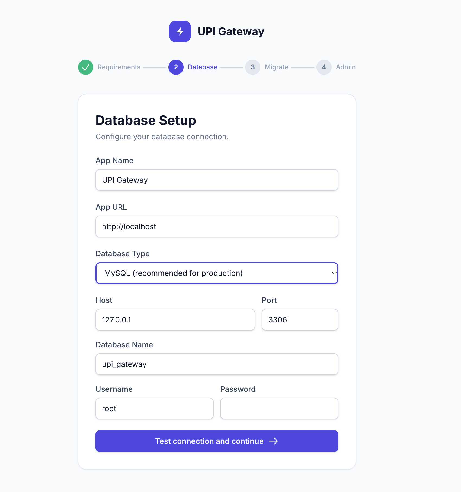
  <br/>
  <sub>Database Setup — enter the MySQL details created in cPanel or configured on your VPS.</sub>
</p>

Use the **Test connection and continue** button to verify the database connection.

#### Step 3 — Run Migrations

After the database connection succeeds, the wizard creates the required application tables.

<p align="center">
  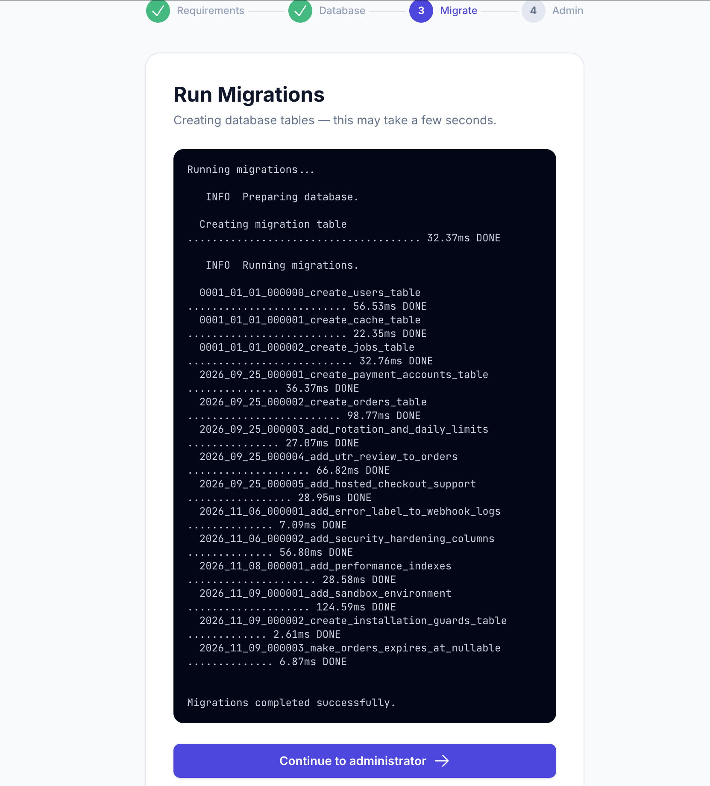
  <br/>
  <sub>Run Migrations — the wizard prepares the database tables.</sub>
</p>

#### Step 4 — Create Admin Account

Create the initial administrator account using your name, email address, and a strong password.

<p align="center">
  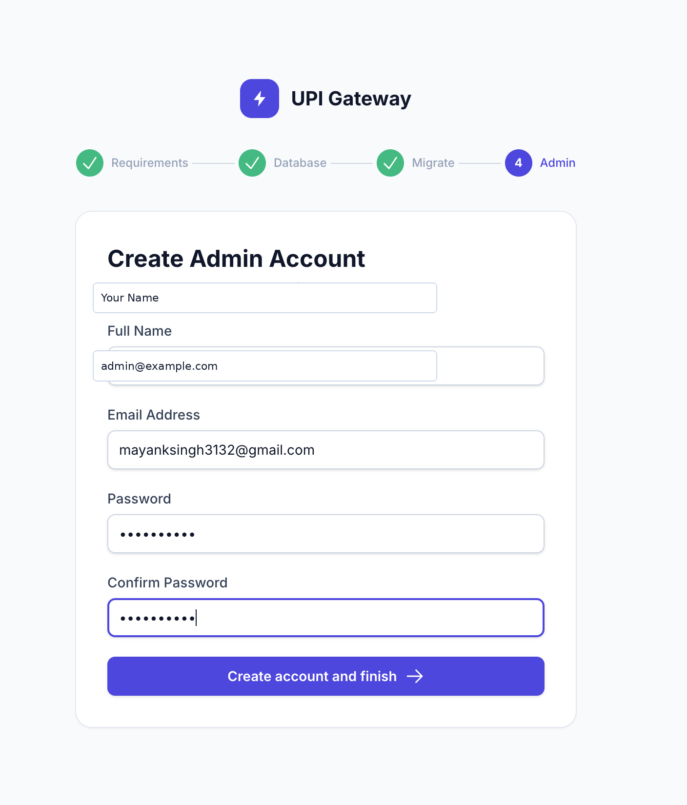
  <br/>
  <sub>Create Admin Account — these credentials are used to access the administration dashboard.</sub>
</p>

After successful setup, sign in to the admin dashboard. The installer is locked after installation; do not bypass or remove the installation protection.

---

## 🔐 Environment Configuration

For command-line or development deployments, configure the following variables in your `.env` file. The browser installer configures the application during guided installation.

| Variable | Description | Example |
|---|---|---|
| `APP_NAME` | Application name | UPI Gateway |
| `APP_ENV` | Application environment | production |
| `APP_DEBUG` | Debug mode | false |
| `APP_URL` | Application URL | https://example.com |
| `DB_CONNECTION` | Database driver | mysql |
| `DB_HOST` | Database host | 127.0.0.1 |
| `DB_DATABASE` | Database name | upi_gateway |
| `DB_USERNAME` | Database username | db_user |
| `DB_PASSWORD` | Database password | Strong password |
| `QUEUE_CONNECTION` | Queue driver | database |

Never commit production credentials or API secrets to GitHub.

---

## 🗄️ MySQL Configuration

MySQL is the required application database. SQLite is not supported by the installer or application runtime.

Example MySQL environment configuration for deployments managed through the command line:

```env
DB_CONNECTION=mysql
DB_HOST=127.0.0.1
DB_PORT=3306
DB_DATABASE=upi_gateway
DB_USERNAME=db_user
DB_PASSWORD=your_password
```

---

## 🔌 Supported Payment Integrations

| Provider | Integration Type | Verification |
|---|---|---|
| Paytm for Business | UPI QR | Available |
| Paytm PG | Hosted Checkout | Official API |
| PhonePe PG | Hosted Checkout | Official API |
| Generic UPI ID | UPI QR | Manual UTR review |

**Integration notes:**

- Paytm for Business verification currently uses an unofficial status API and may stop working without notice.
- Paytm PG and PhonePe PG integrations depend on their respective official API credentials and merchant configurations.
- Generic UPI accounts use manual transaction reference verification.

---

## 📡 API Reference

All merchant API requests require:

```http
X-Api-Key: key_xxx
X-Api-Secret: sec_xxx
```

### Available Endpoints

| Method | Endpoint | Description |
|---|---|---|
| POST | `/api/v1/orders` | Create payment order |
| GET | `/api/v1/orders/{id}` | Retrieve order status |
| GET | `/api/v1/accounts` | List configured UPI accounts |

Full API documentation is available at `/docs` when the application is running.

Sandbox credentials use the `test_key_...` / `test_sec_...` pair and create internal TEST transactions only. Live and Sandbox credentials, orders, account lists, webhook URLs, and financial totals are isolated.

### Create Payment Order

**Request:**

```bash
curl -X POST https://yourdomain.com/api/v1/orders \
  -H "X-Api-Key: key_xxx" \
  -H "X-Api-Secret: sec_xxx" \
  -H "Content-Type: application/json" \
  -d '{
    "amount": 199,
    "client_order_id": "INV1001"
  }'
```

**Example Response:**

```json
{
  "success": true,
  "data": {
    "order_id": "ORDAB12CD34EF56GH78",
    "client_order_id": "INV1001",
    "amount": "199.00",
    "currency": "INR",
    "status": "pending",
    "environment": "live",
    "test": false,
    "payment_url": "https://yourdomain.com/pay/ORDAB12CD34EF56GH78",
    "upi_intent": "upi://pay?pa=merchant@upi&am=199.00&tr=ORDAB12CD34EF56GH78",
    "expires_at": "2026-01-01T12:15:00+05:30"
  }
}
```

The response is illustrative; actual values depend on the application configuration.

---

## 🔔 Webhook Integration

Merchants can configure their webhook endpoint through:

**Dashboard → API & Webhooks**

Webhook events:

- `order.paid`
- `order.expired`
- `order.under_review`
- `order.failed` (Sandbox)
- `order.pending` (Sandbox)
- `order.timeout` (Sandbox)

Each webhook request includes an `X-Signature` header containing an HMAC-SHA256 signature of the raw request body.

### PHP Verification Example

```php
$body = file_get_contents('php://input');

$secret = getenv('PAYMENT_WEBHOOK_SECRET');

$expected = hash_hmac(
    'sha256',
    $body,
    $secret
);

$received = $_SERVER['HTTP_X_SIGNATURE'] ?? '';

if (!hash_equals($expected, $received)) {
    http_response_code(401);
    exit;
}

$event = json_decode($body, true);

switch ($event['event'] ?? '') {
    case 'order.paid':
        // Process successful payment
        break;

    case 'order.expired':
        // Process expired payment
        break;
}
```

---

## 🛡️ Production Security Checklist

Before accepting production traffic:

- Set `APP_ENV=production` and `APP_DEBUG=false`.
- Use HTTPS and a valid TLS certificate.
- Use a strong, unique administrator password.
- Keep database credentials and provider secrets private.
- Point the public document root only to Laravel's `public/` directory.
- Never expose `.env`, application source, or private storage files.
- Keep `storage/` and `bootstrap/cache/` writable only as required by the application user. Do not use `777` as a permanent permission setting.
- Keep the installation lock enabled after successful setup.
- Configure database backups and periodically verify that they can be restored.
- Configure queue processing and scheduled tasks as required by the deployment.
- Keep the operating system, PHP, and application dependencies updated.
- Verify webhook signatures and handle duplicate webhook deliveries safely.

---

## 🏭 Production Deployment

### Release checklist

Set `APP_ENV=production`, `APP_DEBUG=false`, a generated `APP_KEY`, an HTTPS `APP_URL`, secure session cookies, and separate Live/Sandbox webhook URLs. Do not include `.env`, database files, logs, sessions, or development archives in a release package. Take a database backup before running migrations.

The expiry compatibility migration keeps `orders.expires_at` nullable for forward compatibility. Its rollback intentionally stops with an actionable error when NULL rows exist; it never guesses an expiry or alters payment history. Resolve those rows under an approved data policy, verify them, and then rerun the rollback.

For server configuration, queue worker, scheduler, permissions, and SSL instructions, follow the dedicated [cPanel](docs/CPANEL.md) or [Ubuntu VPS](docs/VPS.md) guide.

---

## ➕ Adding a Payment Provider

The platform supports extending payment verification through provider-specific verifier implementations.

### Step 1: Create Verifier

Create:

`app/Services/Verifiers/YourProviderVerifier.php`

```php
class YourProviderVerifier implements Verifier
{
    public function check(Order $order): VerificationResult
    {
        // Call the provider's official API.

        // Return a verified payment result:
        // VerificationResult::paid(
        //     utr: '...',
        //     txnId: '...'
        // );

        // Or return a pending result:
        // VerificationResult::pending();
    }
}
```

### Step 2: Register Provider

Register the provider in `PaymentAccount::PROVIDERS`:

```php
'your_provider' => [
    'label'    => 'Your Provider',
    'verifier' => YourProviderVerifier::class,
    'hosted'   => false,
],
```

Use the provider's official API documentation and authentication requirements when implementing a new integration.

---

## 🧪 Running Tests

Run the application test suite:

```bash
composer run test
```

---

## 📂 Project Structure

```text
upi-gateway/
│
├── app/
│   ├── Http/
│   ├── Models/
│   ├── Services/
│   │   └── Verifiers/
│   └── Jobs/
│
├── bootstrap/
├── config/
├── database/
├── docs/
│   └── images/
│       └── installation/
├── public/
├── resources/
│   ├── views/
│   ├── css/
│   └── js/
├── routes/
├── screenshots/
├── storage/
├── tests/
├── .env.example
├── artisan
├── composer.json
└── package.json
```

This is a representative structure; adapt it to the actual repository layout.

---

## 📄 License

Distributed under the MIT License.

See the `LICENSE` file for details.

---

## 📬 Contact & Connect

Have a question, collaboration idea, business inquiry, or technical discussion? Feel free to get in touch.

<p align="center">
  <a href="mailto:mayanksingh3132@gmail.com">
    
  </a>
  <a href="https://linkedin.com/in/mynk-dev">
    
  </a>
  <a href="https://t.me/mayankdeveloper">
    
  </a>
  <a href="https://github.com/mynkdev-21">
    
  </a>
</p>

### 🌐 Professional Links

| Platform | Details |
|---|---|
| 📧 Email | mayanksingh3132@gmail.com |
| 🌐 Portfolio | [mayankdeveloper.site](https://mayankdeveloper.site) |
| 💼 LinkedIn | [linkedin.com/in/mynk-dev](https://linkedin.com/in/mynk-dev) |
| 🏢 Company | [amtechinfo.online](https://amtechinfo.online) |
| ✈️ Telegram | [@mayankdeveloper](https://t.me/mayankdeveloper) |
| 🐙 GitHub | [@mynkdev-21](https://github.com/mynkdev-21) |

---

<p align="center">
  <b>Have an idea? Let's build something great together.</b>
  <br/>
  <sub>Mayank Singh · Full Stack Developer · Founder @ AmTech INFO</sub>
</p>

<p align="center">
  <b>Built with ❤️ for Indian merchants.</b>
</p>
