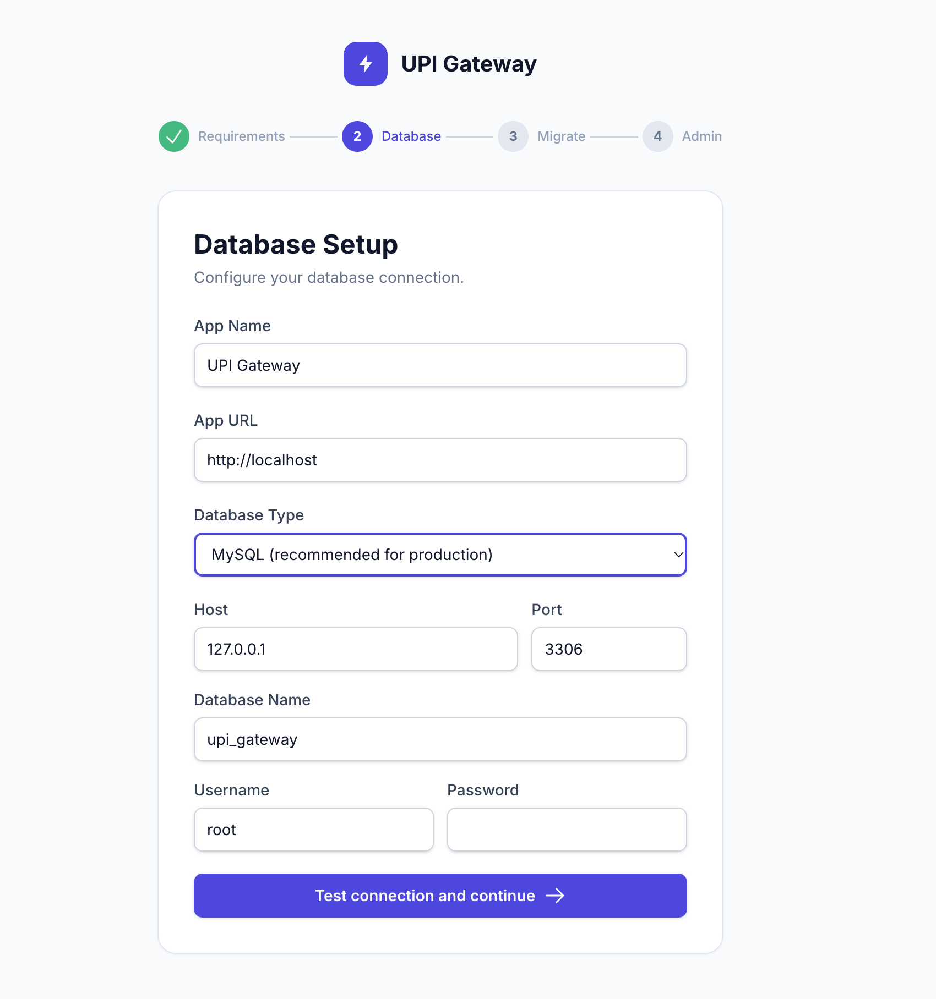
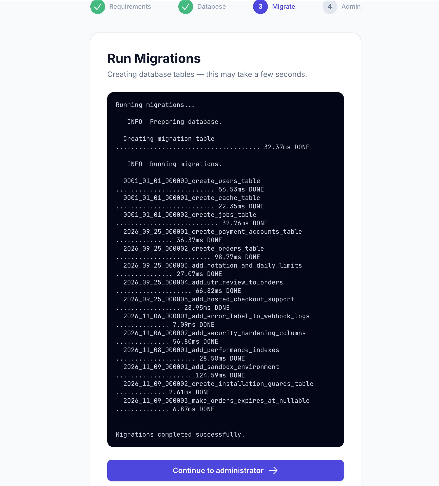
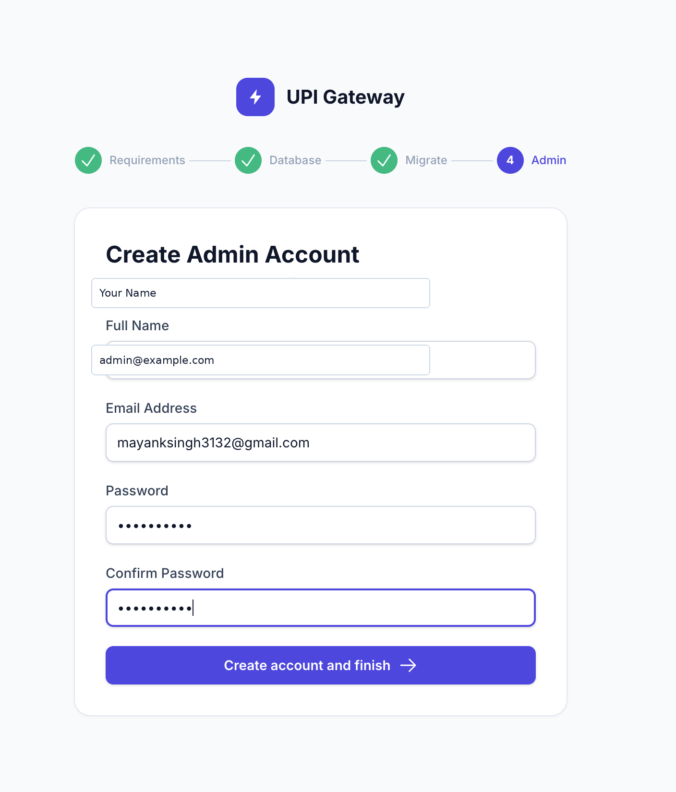

# Web Installation Wizard

Every supported deployment method ends in this browser flow. cPanel and Ubuntu VPS instructions prepare PHP, MySQL, filesystem permissions, and the web server; the wizard then performs application setup.

## Before opening `/install`

Verify PHP 8.2+ and PDO, PDO MySQL, OpenSSL, mbstring, tokenizer, JSON, cURL, fileinfo, and XML. Create an empty MySQL 8.x or MariaDB 10.x/11.x database and a user able to create and alter tables. The prepared package must contain `vendor/autoload.php` and `public/build/`.

The web root must be Laravel's `public/` directory. `storage/` and `bootstrap/cache/` must be writable by PHP, and the application must be able to create `.env`. Use HTTPS in production. SQLite is not supported at runtime.

## Step-by-step wizard

1. Open `https://yourdomain.com/install`.
2. On **Server Requirements**, confirm green checks for PHP, PDO, PDO MySQL, OpenSSL, mbstring, tokenizer, JSON, cURL, writable `storage/`, and writable `.env` handling. Fix missing extensions or permissions and refresh.
3. On **Database Setup**, enter App Name and HTTPS App URL. MySQL is the only database type. Enter host, port (`3306` unless your host says otherwise), full database name, full username, and password, then select **Test connection and continue**.
4. After connection success, the wizard writes `.env` atomically, generates `APP_KEY` when needed, applies production-safe settings, and continues.
5. On **Run Migrations**, start migration to create the required tables. Failures show a generic message; fix database permissions/settings and retry.
6. On **Create Admin Account**, enter Full Name, Email Address, Password, and Confirm Password. The password must be at least 10 characters.
7. On **Installation Complete**, choose **Go to Login**. The installation marker locks the wizard. The API is unavailable before installation and the wizard cannot be reopened after success.

## Screenshots

The following screenshots show the actual Installation Wizard flow:

### Database setup

### Successful migrations

### Create administrator

## After installation

Configure merchant accounts, payment accounts, webhooks, queue processing, scheduled expiry processing, HTTPS, restricted permissions, and MySQL backups. See [CPANEL.md](CPANEL.md) or [VPS.md](VPS.md).
